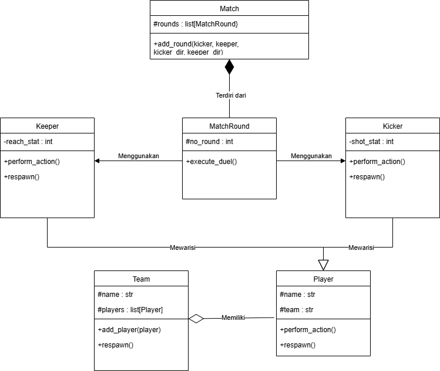

# Simulasi Adu Penalti (Penalty Shootout Simulation)

Program ini merupakan simulasi adu penalti berbasis Object-Oriented Programming (OOP) dengan bahasa pemrograman Python. Program memodelkan entitas pemain bola, tim, hingga jalannya adu penalti ronde per ronde menggunakan konsep Abstraksi, Polimorfisme, dan berbagai relasi antar-kelas (Asosiasi, Agregasi, dan Komposisi).

---

## 1. Class Diagram & Relasi Antar-Kelas

### Class Diagram



### Penjelasan Relasi Antar-Kelas:

1. **Asosiasi (`MatchRound` ke `Player` / `Kicker` & `Keeper`)**

   - **Keterangan:** Kelas `MatchRound` berasosiasi dengan objek `Player` (yaitu `Kicker` dan `Keeper`) sebagai partisipan duel penalti.
   - **Alasan:** `MatchRound` hanya berinteraksi dan menggunakan data dari pemain (`shotStat`, `reachStat`, dan arah tendangan/lompatan) untuk mengalkulasi hasil tendangan tanpa memiliki siklus hidup pemain tersebut. Objek `Player` tetap eksis secara independen baik sebelum maupun sesudah ronde penalti berjalan.
2. **Agregasi (`Team` ke `Player`)**

   - **Keterangan:** Kelas `Team` memiliki relasi agregasi (*has-a relationship*) dengan `Player` melalui daftar `self._players`.
   - **Alasan Memilih Agregasi vs Komposisi:** Seorang pemain (`Player`) dapat eksis tanpa harus terikat pada suatu tim (`team=None`), dan jika objek `Team` dihapus/dibubarkan, objek `Player` tidak ikut terhapus dari sistem.
3. **Komposisi (`Match` ke `MatchRound`)**

   - **Keterangan:** Kelas `Match` memiliki relasi komposisi dengan `MatchRound` melalui daftar `self._rounds`.
   - **Alasan Memilih Komposisi vs Agregasi:** Objek `MatchRound` dibuat langsung di dalam method `Match.add_round()`. Siklus hidup `MatchRound` sepenuhnya terikat pada `Match`; jika pertandingan `Match` selesai atau dihapus, semua catatan histori ronde (`MatchRound`) di dalamnya ikut terhapus dan tidak bermakna di luar pertandingan tersebut.

---

## 2. Penerapan Abstraksi (Abstract Base Class)

Program mengimplementasikan modul bawaan `abc` (`ABC` dan `@abstractmethod`) untuk memastikan rancangan kelas induk yang ketat.

- **Abstract Class:** `Player(ABC)`
  - Tidak dapat diinstansiasi secara langsung dan menjadi blueprint bagi jenis pemain sepak bola lainnya.
- **Abstract Methods:**
  1. `@abstractmethod def perform_action(self)`: Mewajibkan setiap peran pemain memiliki aksi unik saat bertanding.
  2. `@abstractmethod def get_effective_stat(self)`: Mewajibkan setiap jenis pemain mengembalikan nilai stat efektif yang digunakan dalam perbandingan performa.
- **Subclass Pengimplementasi:**
  - `Kicker`: Mengimplementasikan `perform_action()` (menembak) dan `get_effective_stat()` (mengembalikan `shotStat`).
  - `Keeper`: Mengimplementasikan `perform_action()` (melompat menjangkau bola) dan `get_effective_stat()` (mengembalikan `reachStat`).
- **Method Konkret Bersama:**
  - `show_profile()`: Method biasa pada `Player` yang diwarisi dan digunakan bersama oleh seluruh subclass untuk menampilkan nama serta tim pemain.
  - `respawn()`: Method dasar yang dipanggil saat inisialisasi pemain.
- **Bukti Kegagalan Instansiasi:**
  Program membuktikan sifat keabstrakan kelas `Player` dengan blok `try-except TypeError`:
  ```python
  try:
      dummy = Player("Pemain Abstrak")
  except TypeError as err:
      print(f"Berhasil membuktikan kegagalan instansiasi ABC: {err}")
  ```

---

## 3. Penerapan Polimorfisme

### A. Polimorfisme via Pewarisan (Method Overriding)

- **Method:** `perform_action()`
- **Implementasi:** Kelas turunan `Kicker` dan `Keeper` meng-override method ini untuk merepresentasikan aksi spesifik masing-masing peran.
- **Pemanggilan:** Objek dari subclass yang berbeda digabungkan dalam satu iterable (`player_list = [kicker1, keeper2]`) lalu dipanggil secara seragam melalui satu perulangan `for`:
  ```python
  player_list = [kicker1, keeper2]
  for i in player_list:
      print(i.perform_action())
  ```

### B. Duck Typing

- **Method Bersama:** `respawn()`
- **Penerapan:** Kelas `Player` (beserta turunannya) dan kelas `Team` merupakan dua kelas yang **tidak terhubung lewat hubungan pewarisan (inheritance)**, tetapi keduanya sama-sama memiliki method bernama `respawn()`.
- **Fungsi Pemanggil:** Disediakan fungsi independen `initiate_match(participant)` yang memanggil method `.respawn()` tanpa mempedulikan tipe objek asalkan objek tersebut memiliki atribut/method yang diminta:
  ```python
  def initiate_match(participant):
      participant.respawn()

  initiate_match(kicker2)  # Objek Kicker
  initiate_match(team2)    # Objek Team
  ```

### C. Operator Overloading (Magic Methods)

Penerapan operator overloading terdapat pada kelas `Player`:

1. `__str__(self)`: Mengubah representasi string dari objek pemain saat dipanggil dengan `print(player)` (menampilkan nama kelas, nama pemain, dan statistik efektifnya).
2. `__gt__(self, other)`: Mengizinkan pemakaian operator pembanding lebih besar (`>`) langsung di antara dua objek pemain berdasarkan statistik efektif mereka (`get_effective_stat()`).

---

## 4. Screenshot Output Program

> *Catatan: Letakkan hasil tangkapan layar output terminal Anda di bawah ini.*

```text
=== 1. ABSTRAKSI ===
Berhasil membuktikan kegagalan instansiasi ABC: Can't instantiate abstract class Player without an implementation for abstract methods 'get_effective_stat', 'perform_action'

Berhasil menambah tim Barcelona
Berhasil menambah tim Madrid
Berhasil menambah pemain atas nama Baker
Berhasil menambah penendang atas nama Baker
Berhasil menambah pemain atas nama Chanatip
Berhasil menambah penendang atas nama Chanatip

Berhasil menambah pemain atas nama Emil
Berhasil menambah kiper atas nama Emil
Berhasil menambah pemain atas nama Paes
Berhasil menambah kiper atas nama Paes

Berhasil menambah Baker ke dalam tim Barcelona
Berhasil menambah Emil ke dalam tim Barcelona
Berhasil menambah Chanatip ke dalam tim Madrid
Berhasil menambah Paes ke dalam tim Madrid

=== 2. METHOD KONKRET BERSAMA DARI ABSTRACT CLASS ===
[Kicker] Nama: Baker | Tim: Tim Barcelona
[Keeper] Nama: Emil | Tim: Tim Barcelona

=== 3. POLIMORPISME ===
Baker melepaskan tembakan terarah dengan daya 80!
Paes melompat meregangkan badan menjangkau bola (Jangkauan: 70)!

=== 4. DUCK TYPING ===
Berhasil menambah penendang atas nama Chanatip
Berhasil menambah tim Madrid

=== 5. OPERATOR OVERLOADING ===
[Kicker] Baker (Stat: 80)
[Keeper] Emil (Stat: 85)
Stat Baker lebih besar dari pada stat [Kicker] Chanatip (Stat: 75)

=== 6. SIMULASI PERTANDINGAN (KOMPOSISI & ASOSIASI) ===

[Putaran 1]

Baker (Barcelona) menembak ke kanan |
Paes (Madrid) melompat ke kanan

-> GOL! Tembakan terlalu keras meski arah terbaca!

[Putaran 2]

Chanatip (Madrid) menembak ke kiri |
Emil (Barcelona) melompat ke tengah

-> GOL! Kiper salah membaca arah bola!

Skor Akhir: {'Barcelona': 1, 'Madrid': 1}
```
